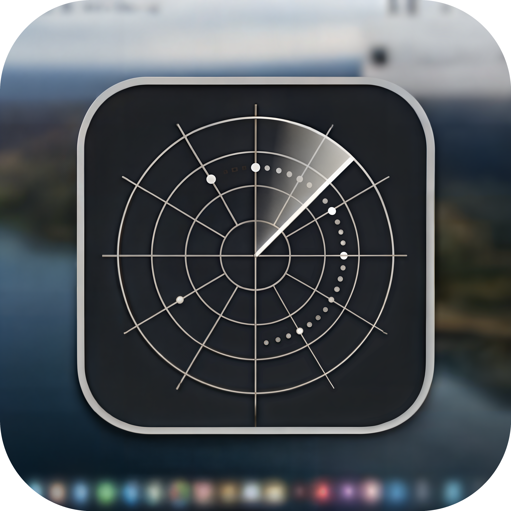
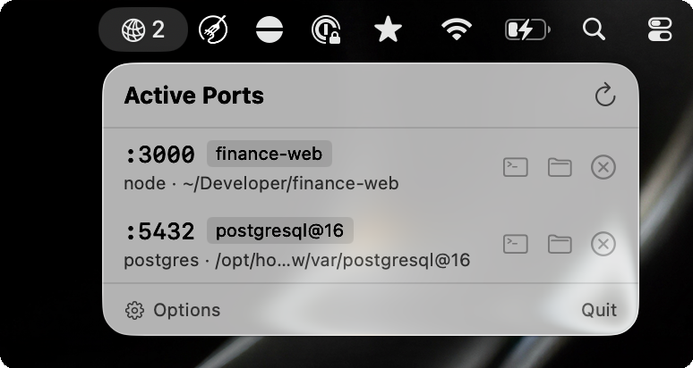

<p align="center">
  
</p>

<h1 align="center">pscan</h1>

<p align="center">
  Menu bar app to monitor and manage your localhost ports.
</p>

<p align="center">
  <a href="https://github.com/mavideniz/pscan/releases/latest">Download</a> · <a href="#cli">CLI</a> · <a href="#license">License</a>
</p>

---

<p align="center">
  
</p>

## Features

- See active dev server ports at a glance from the menu bar
- Project name and directory detection
- Open in browser, Terminal, or Finder with one click
- Kill processes with confirmation
- Active port count badge
- Launch at login
- Configurable via Options window

## Install

### Menu Bar App

Download the latest `.zip` from [Releases](https://github.com/mavideniz/pscan/releases/latest) or [World Vibe Web](https://wvw.dev), unzip, and move `pscan.app` to Applications.

### CLI

```
brew install mavideniz/pscan/pscan
```

Or build from source:

```
swift build -c release
cp .build/release/pscan /usr/local/bin/pscan
```

## CLI

```
$ pscan
PORT    PROCESS       PROJECT               DIRECTORY
────────────────────────────────────────────────────────────────────────
:3000   node          finance-web           ~/Developer/finance-web
:3001   node          admin-panel           ~/Developer/admin-panel
:5173   vite          landing-page          ~/Developer/landing-page
```

### Options

| Flag | Description |
|------|-------------|
| `-a, --all` | Show all ports including system services |
| `-j, --json` | Output as JSON |
| `-k, --kill PORT` | Kill the process on a given port |
| `-h, --help` | Show help |

## Requirements

- macOS 13+

## License

[MIT](LICENSE)
